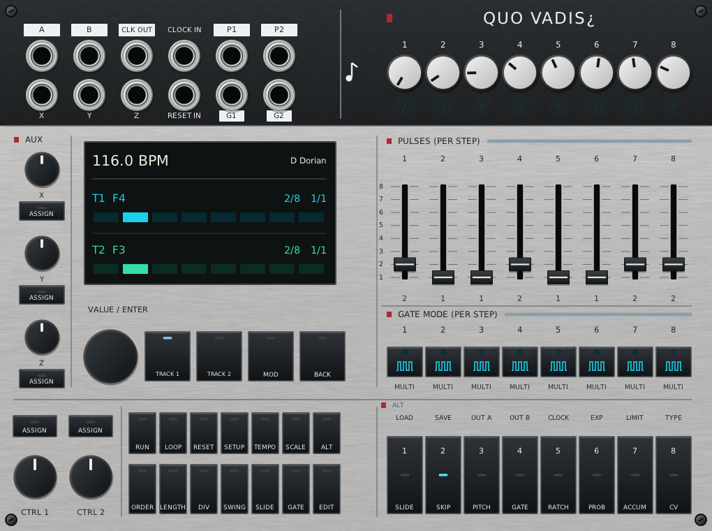

# Quo Vadis¿ for VCV Rack 2

[](https://github.com/spliffrider/Quo-Vadis/actions/workflows/engine-tests.yml)

A two-track sequencer with eight shared stages, eight modulation lanes and an
optional MX expander. Shape each track with pulse counts, independent timing,
ratchets, probability, accumulators and preset chains. It generates pitch,
gates, modulation and MIDI; connect voice modules or open a demo patch to hear it.



This repository is public. The **2.72.5 Windows preview** is available below.

[Download 2.72.5](https://github.com/spliffrider/Quo-Vadis/releases/tag/v2.72.5) ·
[Panel and controls](docs/QUO-VADIS-UI.md) · [Feature details](docs/FEATURE-STATUS.md) ·
[Example patches](examples/) · [Report feedback](https://github.com/spliffrider/Quo-Vadis/issues/new?template=test-feedback.md)

## Features

- Two note tracks with independent length, offset, clock division, transpose and play order.
- Eight aligned pitch, pulse and gate stages; per-stage skip, probability,
  ratchets, overrides and CV, plus swing and slide options.
- Shared scale quantization with factory and custom scales; stage/track accumulators.
- Eight MOD lanes, three AUX CV inputs, two assignable CTRL knobs and optional MX gate/clock outputs.
- User presets, selective recall, pickup, preset chains and JSON backups.
- Internal/external clock, reset, MIDI notes/CC/clock/transport and MIDI control.
- Mouse/keyboard editing, direct value menus, undo/redo and an optional performance view.

Right-click the module background → **Panel style → Black / silver** or
**Brushed silver**. The choice is saved in the patch. Both use simple mixer-style
markings, black fader caps and satin silver pitch knobs, with precisely aligned
stage columns. The former Roman style now opens as Brushed silver.

## Install the Windows preview

1. Download the Windows `.vcvplugin` from the
   [2.72.5 release](https://github.com/spliffrider/Quo-Vadis/releases/tag/v2.72.5).
2. In Rack, choose **Help → Open user folder**, save your patch and close Rack.
3. Put the intact package in `plugins-win-x64`. **Do not extract it.**
4. Restart Rack and search for **Quo Vadis¿** or **MX**.

The plugin is not in the VCV Library. Existing patches retain their programmed
values and cable connections: internal `MetropolixLab` / `Metropolix` identifiers
remain for compatibility. The package's internal folder also retains that ID.

## Play and edit

Drag upward to increase a value and downward to decrease it. Use Shift for
fine adjustment, hover for help and right-click for direct values or named choices.
Select **TRACK 1**, **TRACK 2** or **MOD** before editing; **ALT** exposes secondary
functions, and **BACK** returns through display pages.

Hover over the module and press **Shift+P** for the performance view. Click
**CLICK TO ARM KEYBOARD** to use stage keys 1–8; Escape releases and disarms.
See [desktop performance](docs/DESKTOP-PERFORMANCE.md) and the
[control guide](docs/HARDWARE-UI.md).

Try [Scale progression](examples/Scale-progression.vcv),
[Pulse Pressure](examples/Pulse-Pressure.vcv) or the
[desktop performance patch](examples/Pulse-Pressure-Desktop.vcv).
Install the patch's other modules, select an audio device in **AUDIO** and enable
**RUN** if stopped. Some demos start running on load.

## Validation and limits

The 2.72.5 layout was built and checked in Windows Rack Free 2.6.6, including
stage dragging, button targets, theme switching and patch save/reopen.
[Current panel evidence](docs/QUO-VADIS-UI.md) records the scope. The latest
redesign has not yet received equivalent Linux/macOS GUI validation; earlier
platform evidence is documented separately in [platform coverage](docs/PLATFORMS.md).

Human playtesting, unusual zoom/DPI settings, other Rack versions and long
sessions with other plugins still need broader coverage. Hardware behavior
has not been verified against a physical unit. Hardware SysEx import/export
and the original hardware factory preset bank are not included; JSON backups
belong to this plugin. Separate per-track scales are not implemented.

## Build and test

On Windows, with Rack installed:

```powershell
./scripts/setup-windows.ps1
./scripts/build.ps1 -Test -Package
./scripts/test-rack.ps1
./scripts/test-production.ps1
./scripts/test-panel-styles.ps1
```

Application checks use isolated profiles and require Rack to be closed.
See [development](docs/DEVELOPMENT.md), [runtime validation](docs/RUNTIME-VALIDATION.md)
and [current UI requirements](docs/UI-TARGET.md) for build and review details.
Legacy source/test identifiers and historical regression fixtures remain;
the new repository does not import the retired repository's Git history.

The software license is **proprietary**. Panel graphics are drawn in code;
typography uses Rack's bundled font. See [asset notes](res/README.txt).
